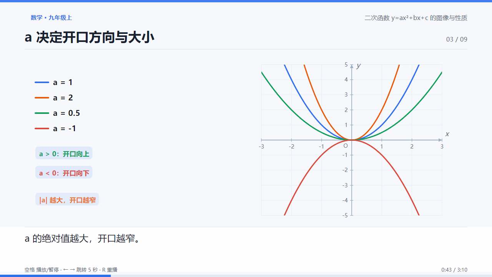
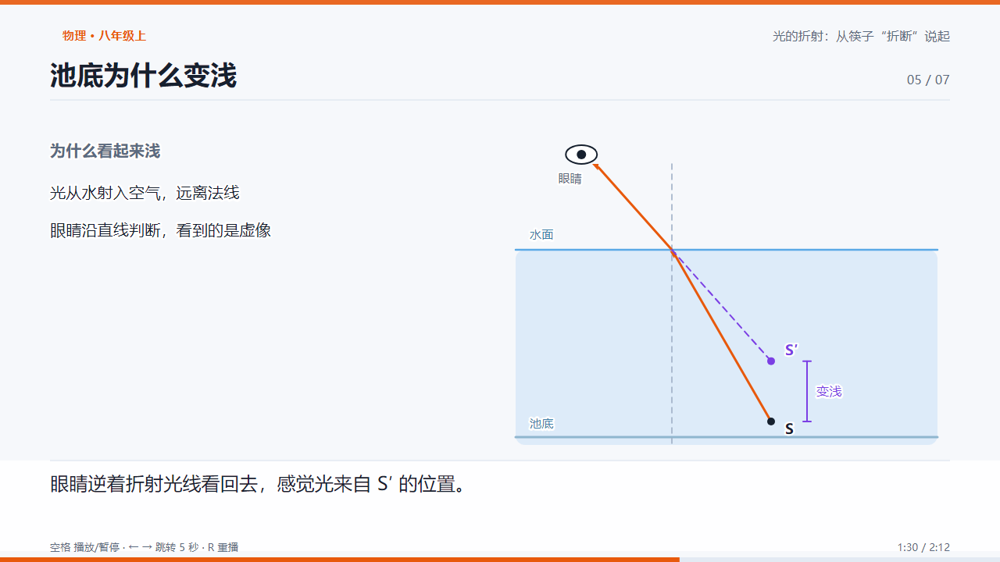
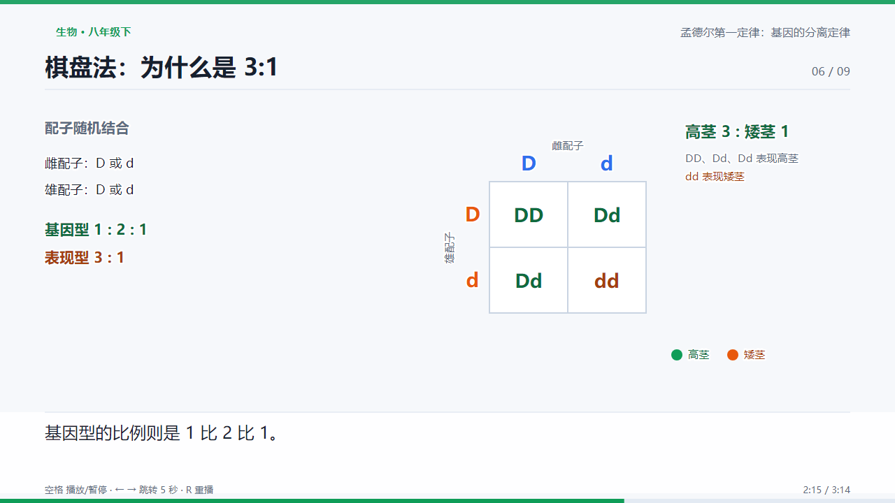
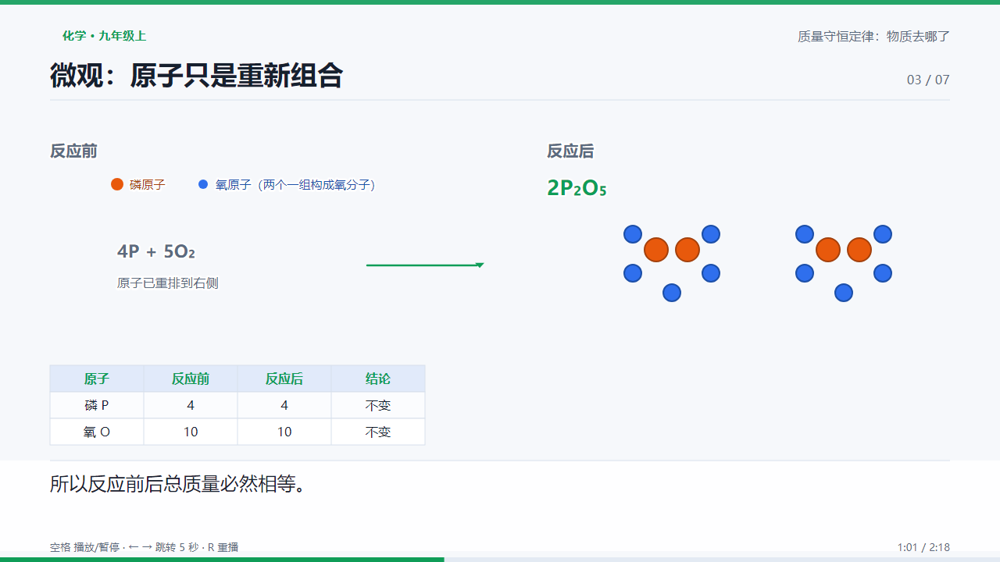

# 中学知识点讲解动画

把一个中学知识点，做成**能在浏览器里直接播放、可逐帧检查、内容经得起核对**的讲解动画。

不输出提示词，不输出分镜文档，输出 `lesson.html`：单文件、离线可播、可拖动进度。


<table>
<tr>
<td width="50%"></td>
<td width="50%"></td>
</tr>
<tr>
<td></td>
<td></td>
</tr>
</table>

> 截图均来自仓库内可播放的示例，不是设计稿。

## 它解决什么问题

用 AI 生成课件，最常见的三个失败是：

1. **只给提示词或大纲**，没有能放的成品；
2. **能打开但没法验收**，"看起来还行"掩盖了公式错、字幕压图、时间轴断裂；
3. **技术堆得很重**，最后一堆依赖跑不起来。

这个项目的做法是：

- 动画 = **时间的纯函数**。任意时刻 `seek(t)` 可复现同一帧，所以能自动化逐帧截图检查。
- 引擎内联进单文件 HTML，**零依赖、不联网**，双击就能放。
- 每个知识点必须挂 **数值断言（probe）**：顶点坐标、折射角、原子数、后代比例……代码算出来的值要和人讲的结论一致。
- 分镜从实现反向导出，**文档不可能和代码脱节**。

## 13 个示例

每个都点开即播（`examples/<学科>/<知识点>/lesson.html`）。

| 学科 | 知识点 | 时长 | 难度 |
|---|---|---|---|
| 数学 | 二次函数 y=ax²+bx+c 的图像与性质 | 190s | 中 |
| 数学 | 勾股定理 | 154s | 中 |
| 数学 | 三角形全等的判定 | 148s | 中 |
| 数学 | 一次函数 y=kx+b | 112s | 易 |
| 物理 | 光的折射 | 132s | 难 |
| 物理 | 牛顿第一定律 | 142s | 中 |
| 物理 | 串联与并联 | 138s | 难 |
| 物理 | 浮力（阿基米德原理） | 126s | 中 |
| 化学 | 质量守恒定律 | 138s | 中 |
| 化学 | 原子结构 | 134s | 中 |
| 生物 | 光合作用 | 160s | 难 |
| 生物 | 细胞的结构 | 114s | 易 |
| 生物 | 孟德尔第一定律 | 194s | 中 |

时长按复杂度估算（引入 12s + 核心点 ×22s + 应用 25s + 总结 12s，再按实验/推导上浮），不是一律 60 秒。

更多画面：`docs/screenshots/`。

## 快速开始

```bash
git clone https://github.com/orangefive/middle-school-edu-animation.git
cd middle-school-edu-animation

# 1. 直接看（无需安装任何东西）
#    双击 examples/mathematics/quadratic-function/lesson.html

# 2. 环境自检
python scripts/doctor.py

# 3. 构建全部课程
python scripts/build_lesson.py --all

# 4. 自动验证（需要 Node + Playwright）
cd scripts && npm ci && npx playwright install chromium && cd ..
node scripts/verify_lesson.js examples/biology/mendel-first-law/lesson.html --case B3-mendel
```

播放控制：`空格` 播放/暂停 · `← →` 跳 5 秒 · `R` 重播 · 点击底部进度条定位。
URL 参数：`?t=42` 从第 42 秒开始，`?speed=1.5` 倍速。

## 用一个新的知识点

对支持 `SKILL.md` 的 Agent 说：

> 用 middle-school-edu-animation，做一个《光的反射》的八年级物理动画，讲清反射角等于入射角。

或者手动按五阶段走：

1. **分析**：学段、目标、先备知识、误解、核心点、时长估算
2. **分镜**：镜头目标、画面、运动、字幕、衔接、验证点
3. **选型**：默认 SVG + 原生 JS；>200 粒子才用 Canvas
4. **实现**：复制 `templates/lesson-src-template.html`，写 `build(ctx)`
5. **验收**：构建 → 导出分镜 → 逐帧验证 → 人工评分

```bash
cp templates/lesson-src-template.html examples/physics/reflection/lesson.src.html
python scripts/build_lesson.py examples/physics/reflection
node scripts/export_storyboard.js examples/physics/reflection/lesson.html
node scripts/verify_lesson.js examples/physics/reflection/lesson.html
```

## 质量体系

自动检查（`scripts/verify_lesson.js`，真实 Chromium）：

| 类别 | 检查 |
|---|---|
| 时间轴 | 总时长、镜头首尾闭合、分镜与实现一致 |
| 排版 | 文字越界、侵入字幕区、文字重叠、字号下限、**文字与底色对比度** |
| 画面 | 空白帧、0.25s 内异常跳变、镜头后段静止 |
| 知识 | `probe` 数值断言、必现关键词、禁用错误表述 |
| 交付 | 单文件自包含、离线、控制台 0 错误、1024/1920 两档可读 |

人工评审（`tests/evaluation-rubric.md`）负责自动检查查不到的部分：讲解是否易懂、动效是否真在表达关系、镜头节奏。

当前基线（13 个用例，2026-10）：

- 自动检查 **13/13 通过**，平均 100
- 人工评分平均 **85.2**（知识 23.5/25、逻辑 16.6/20、动画 15.0/20、视觉 11.9/15、时间轴 9.0/10、工程 10/10）
- 综合分平均 **91.1**（0.4×自动 + 0.6×人工）

完整数据：`tests/baseline-results.json`、`outputs/reports/final-report.md`。

## 安装成 Agent Skill

```bash
# 项目级（推荐）
git clone https://github.com/orangefive/middle-school-edu-animation.git \
  <你的项目>/.workbuddy/skills/middle-school-edu-animation
```

也可以放在 `~/.workbuddy/skills/`（用户级）或 `.claude/skills/`。
**注意**：新放入的技能通常要新开一次会话才会被 Agent 发现。

如果不想让产物写进技能目录：

```bash
python <skill>/scripts/init_project.py ~/my-edu-anim
```

| 你的环境 | 能做什么 |
|---|---|
| 只有浏览器 | 播放仓库里 13 个已构建的 `lesson.html` |
| Python 3.9+ | 构建、改写课程；不能导出分镜、不能自动验证 |
| Python + Node + Chromium | 全流程：构建、分镜、逐帧验证、评分 |

详见 [INSTALL.md](INSTALL.md)。

## 架构

```
SKILL.md                 Agent 执行流程：五阶段 + 质量门槛
references/              教学设计、分镜、学科规则、评分、技术契约、验证手册
templates/               分镜 JSON、脚本 MD、课程 HTML 骨架
assets/engine/           时间轴引擎（SVG + 原生 JS，868 行）
examples/                13 个课程（源文件 + 构建产物 + storyboard）
scripts/                 build / validate / verify / export_storyboard / run_tests / doctor / init_project
tests/                   13 个用例、评分表、人工分、基线
```

引擎核心只有一件事：

```js
ctx.tween(t0, dur, (p) => { /* 只依赖 p，不读上一帧 */ });
```

所有镜头在同一根时间轴上，`seek()` 时重放全部轨道。没有 CSS animation，没有 `setTimeout`，没有随机数。

## 已知限制

- 自动检查是**离散采样**（每镜 3 帧 + 跳变/静止检测），0.2 秒内的瞬时错误可能漏检。
- 文字压图形只做了对比度近似检测，图形之间的错误重叠检测不到。
- 人工评分目前是**开发 Agent 自评**，存在确认偏差；关键知识仍建议对照教材复核。
- 未做 Firefox / Safari 逐项回归，也未做真实课堂验证。
- 概念课（如一次函数、细胞结构）仍偏"文字逐行出现"，动画表现力是当前最大短板。

这些问题都写在 `outputs/reports/final-report.md` 里，没有藏。

## 依赖

- 播放动画：**无**（浏览器即可）
- 构建：Python 3.9+ 标准库
- 分镜导出 / 自动验证：Node 18+、Playwright、Chromium（约 160 MB，仅开发时需要）

## License

[MIT](LICENSE)。教学文案与课件内容同样以 MIT 发布，可自由用于课堂、校本课程与二次开发。
